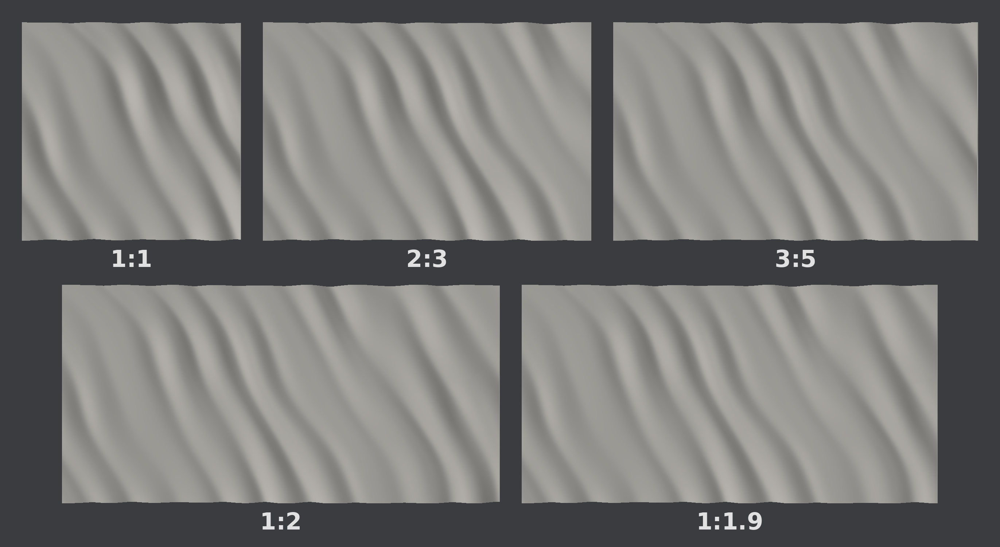
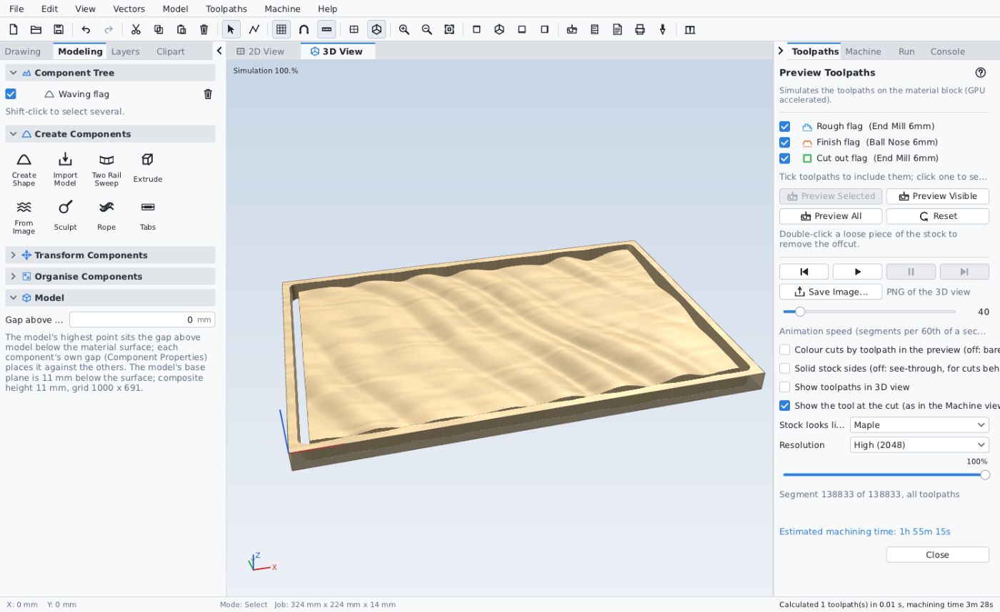

# Wavy flag bases

`wavy-flags.carvioclips`: five 3D clips of a flag rippling in the wind, one for each common flag
ratio (hoist : fly). Lay flag artwork over one to give any flag a waving look.

| Clip | Size (W x H x Z) |
|---|---|
| Wavy flag 1:1 | 200 x 200 x 11 mm |
| Wavy flag 2:3 | 300 x 200 x 11 mm |
| Wavy flag 3:5 | 333.3 x 200 x 11 mm |
| Wavy flag 1:2 | 400 x 200 x 11 mm |
| Wavy flag 1:1.9 | 380 x 200 x 11 mm |

- Every flag is 200 mm on the hoist, so the folds are the same size on all of them.
- Ripple: 8 mm from the deepest trough to the highest crest, on a 3 mm solid base (11 mm in all).
- Folds run diagonally from the top near the hoist down towards the fly, bow slightly, and get
  wider and deeper towards the fly. Top and bottom edges dip up to 1.2 mm at the troughs; the
  hoist edge is straight.

This is the pack sold in the carviocnc.com store. The Carvio repository keeps its own copy in
`store/clipart/` for `seed_store.php`.

## Source

- `source/make_wavy_flags.py` makes the flags as closed STL meshes (1 mm mesh spacing) and their
  wavy outlines: `python3 make_wavy_flags.py [out-dir]` (numpy, Pillow). HOIST, RIPPLE, BASE,
  CELL and EDGE_WAVE at the top set the size, depth and detail; the seed in `build()` gives a
  different fold pattern. The STLs are not kept here, since the script remakes them.
- `source/wavy-flag-*-outline.svg` are the wavy outlines as vectors, for the cut-out profile or
  for clipping artwork to the flag.
- `source/make_flag_pack.nim` (a copy of Carvio's `tools/make_flag_pack.nim`) turns the STLs
  into the pack. From the Carvio repo root:
  `nim r -d:release tools/make_flag_pack.nim <folder of wavy-flag-*.stl> [dir]` writes
  `<dir>/clipart/wavy-flags.carvioclips` (`store/` by default).
